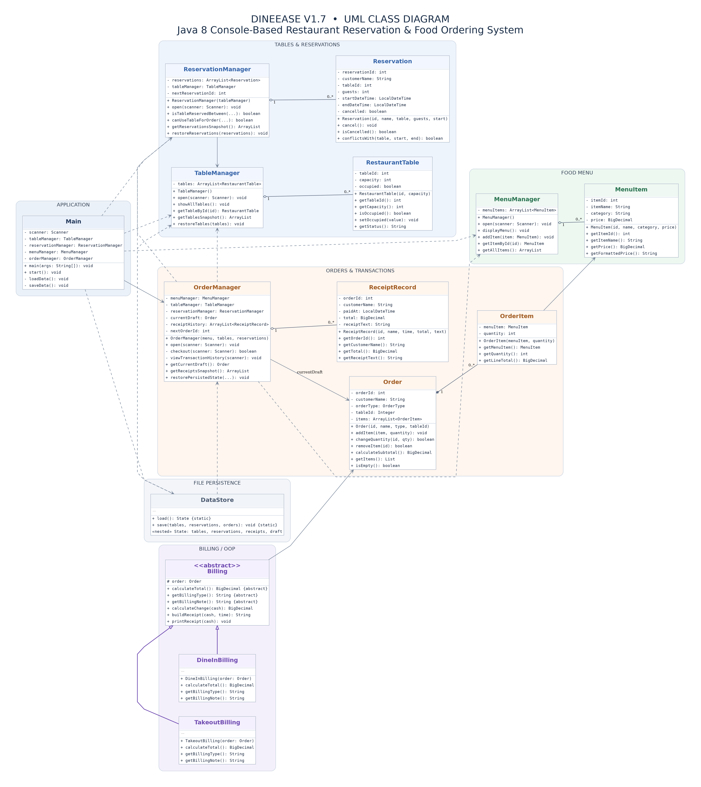
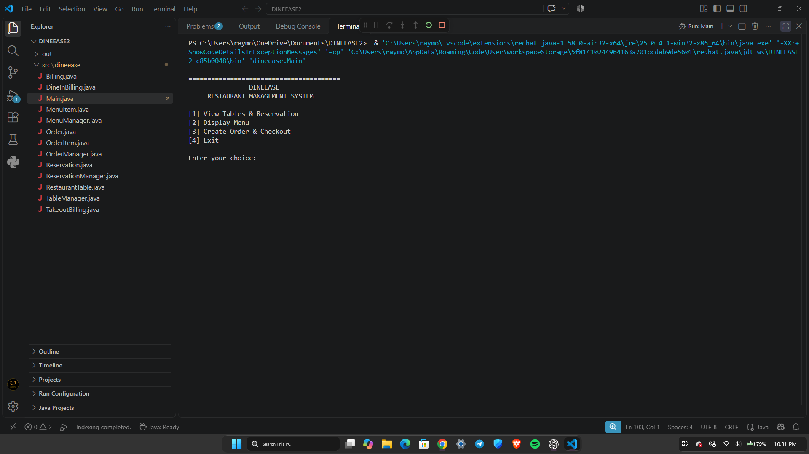
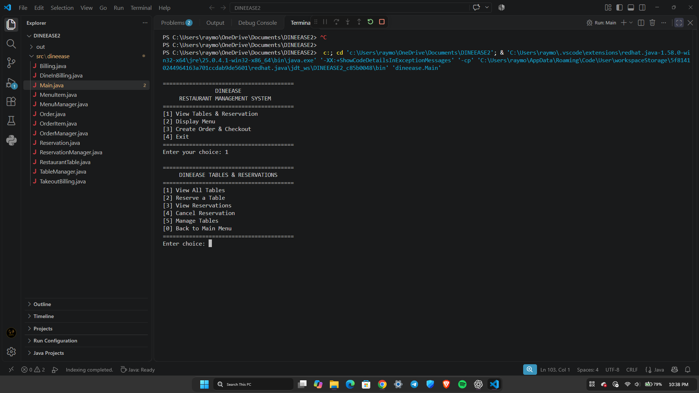
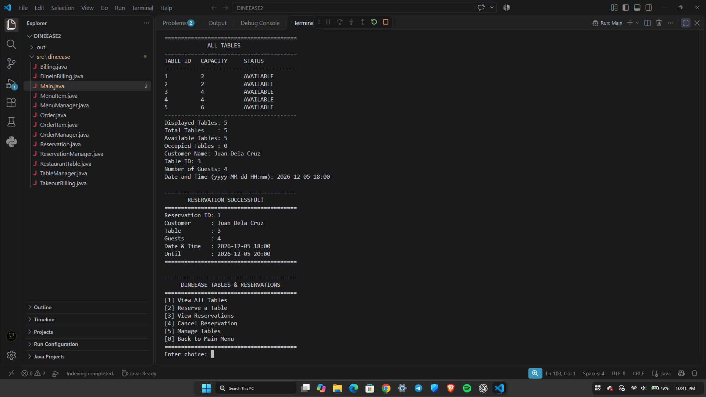
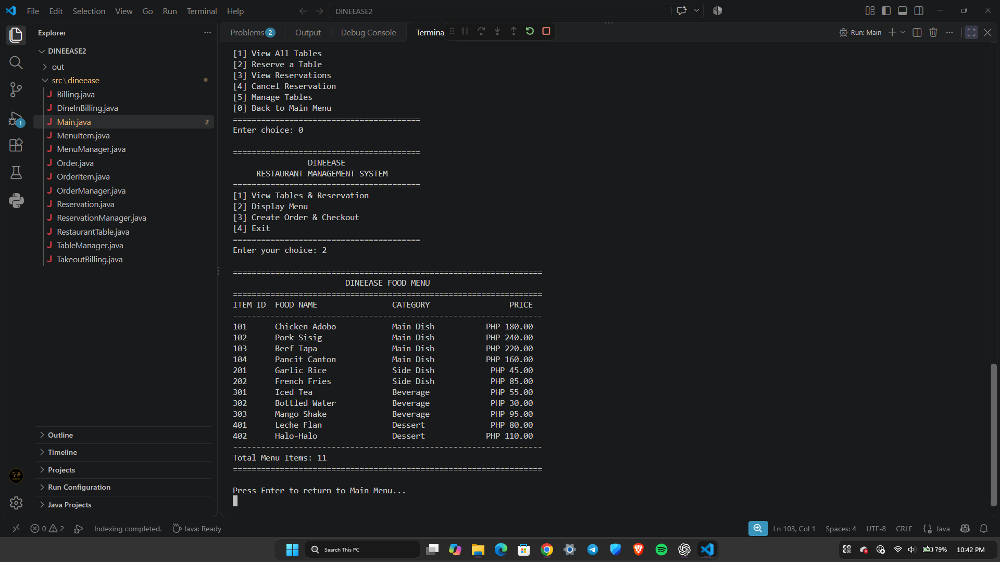
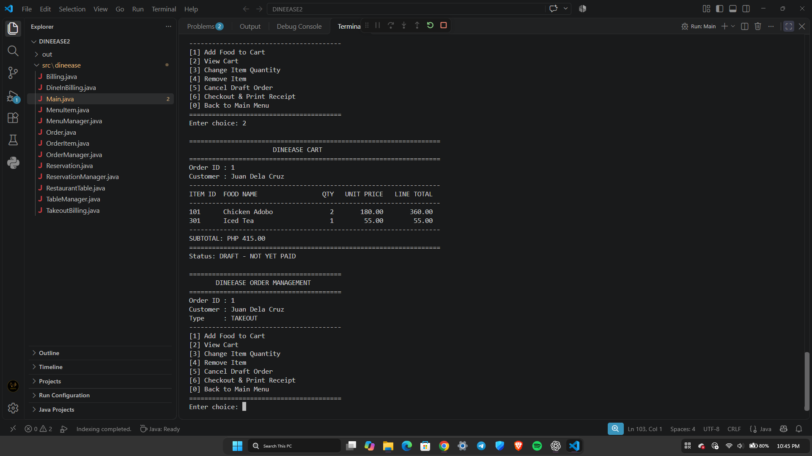
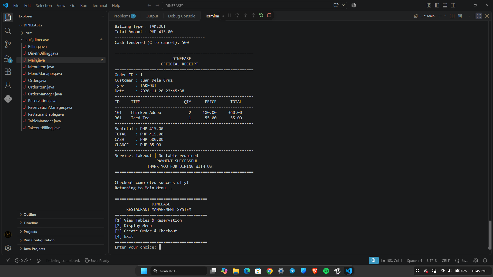
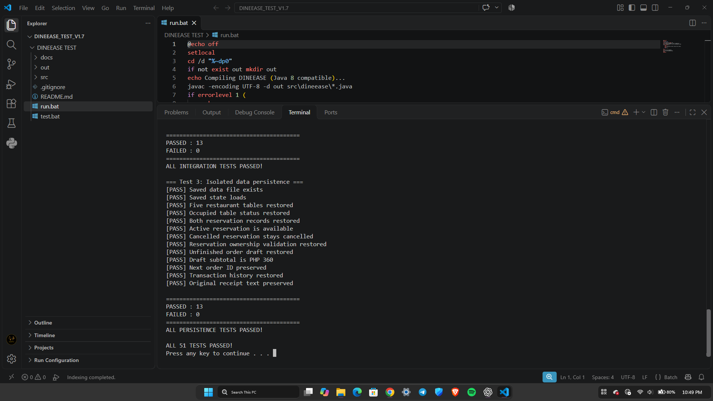

# DINEEASE: Modular Restaurant Table Reservation and Food Ordering Management System

**Version:** 1.7  
**Course:** OOP 101 – Object-Oriented Programming  
**Academic Year:** 2026–2027  
**Application Type:** Java Console-Based Application  
**Programming Language:** Java 8

## Project Overview

DINEEASE is a Java-based modular restaurant table reservation and food ordering management system developed using Object-Oriented Programming (OOP) principles.

The application is designed to help restaurant staff manage table reservations, monitor table availability, display food menus, process customer orders, handle payments, and maintain transaction records.

DINEEASE demonstrates four fundamental OOP principles: **Encapsulation, Inheritance, Polymorphism, and Abstraction**.

## Project Background

In today's modern world, technology plays an important role in improving business operations, especially in the food and restaurant industry.

Some restaurants still use manual methods to manage table reservations and food orders, which may result in double bookings, incorrect orders, delayed service, and difficulties monitoring table availability.

DINEEASE aims to simplify these tasks through a centralized digital system. It provides separate but connected modules for managing reservations, food orders, payments, and restaurant records.

The system aims to reduce manual errors, improve workflow, and provide more organized restaurant services.

## Project Objectives

### General Objective

To develop a Java-based restaurant table reservation and food ordering management system that improves the organization of restaurant operations using Object-Oriented Programming principles.

### Specific Objectives

1. To develop a table reservation system that prevents overlapping reservations.
2. To provide a food menu displaying available items and prices.
3. To implement a shopping cart for managing customer orders.
4. To calculate order totals and process cash payments accurately.
5. To generate itemized receipts and calculate customer change.
6. To implement automatic data saving and transaction history.
7. To demonstrate Encapsulation, Inheritance, Polymorphism, and Abstraction.
8. To implement input validation and exception handling.

## Target Users

| User | How They Use the System |
|---|---|
| Restaurant Staff | Manage table reservations, customer orders, and payments. |
| Restaurant Manager | Monitor table availability, reservations, and transaction records. |
| Customers | Request table reservations and place food orders through restaurant staff. |

## System Requirements

- Java Development Kit (JDK) 8 or newer
- Visual Studio Code or another Java-compatible IDE
- Windows Command Prompt or PowerShell
- No external Java dependencies
- No database server required

## Installation and Running Instructions

### Option 1: Run Using Batch File

1. Download or clone the GitHub repository.
2. Open the project folder in Visual Studio Code.
3. Open the `DINEEASE TEST` folder containing `run.bat`.
4. Double-click `run.bat` to compile and run the application.

### Option 2: Run Using Terminal

Open a terminal in the `DINEEASE TEST` project folder.

**Compile:**

```cmd
mkdir out
javac -encoding UTF-8 -d out src\dineease\*.java
```

Skip `mkdir out` if the folder already exists.

**Run:**

```cmd
java -cp out dineease.Main
```

## Main Menu

```text
========================================
                DINEEASE
     RESTAURANT MANAGEMENT SYSTEM
========================================
[1] View Tables & Reservation
[2] Display Menu
[3] Create Order & Checkout
[4] Exit
========================================
Enter your choice:
```

## Main Features

### 1. Table Management and Reservations

- Display restaurant tables and seating capacities.
- Check available and occupied tables.
- Create and cancel reservations.
- Prevent overlapping table reservations.
- Validate reservation ownership and scheduled booking times.
- Update table occupancy.

### 2. Food Menu

- Display 11 sample food and beverage items.
- Show item IDs, categories, and prices.
- Validate menu item selections.
- Prevent duplicate menu item IDs.

### 3. Food Ordering and Shopping Cart

- Create Dine-In or Takeout orders.
- Add food items to a cart.
- Update item quantities.
- Remove food items.
- Automatically calculate subtotals.
- Preserve unfinished order drafts.

### 4. Checkout and Billing

- Process cash payments.
- Reject insufficient payments.
- Calculate change using `BigDecimal`.
- Generate itemized receipts.
- Support Dine-In and Takeout billing.
- Demonstrate polymorphism through billing subclasses.

### 5. Transaction History

- Save completed transactions.
- Store receipt details.
- Retrieve previous transactions.
- View and reprint saved receipt text.

To access transaction history, select Option 3 from the main menu and enter `/history` as the customer name. It can also be accessed using Option 7 inside an active order draft.

### 6. Automatic Data Saving

DINEEASE uses Java file handling to store:

- Table information
- Reservations
- Table occupancy
- Unfinished order drafts
- Completed transactions
- Receipt records

Saved information is stored locally in:

`data/dineease.properties`

Data is loaded when the application starts and saved when returning from reservation or ordering modules and during normal application exit.

## Java and Object-Oriented Programming Concepts

### 1. Classes and Objects

The system uses classes such as `RestaurantTable`, `Reservation`, `MenuItem`, and `Order` to represent restaurant information and operations.

### 2. Methods

Methods manage reservations, food orders, total calculations, payment processing, and receipt generation.

### 3. Encapsulation

Private variables and public methods protect restaurant, customer, reservation, and order information.

### 4. Inheritance

The `DineInBilling` and `TakeoutBilling` classes inherit common properties and methods from the abstract `Billing` class.

### 5. Polymorphism

Different billing types use overridden methods such as `calculateTotal()` to process Dine-In and Takeout orders.

### 6. Abstraction

The abstract `Billing` class defines common billing operations while allowing specific billing types to implement their own behavior.

### 7. Exception Handling

Try-catch statements and input validation handle invalid inputs, incorrect dates, quantities, and insufficient payments.

### 8. Arrays and Data Handling

`ArrayList` collections store and manage restaurant tables, reservations, menu items, orders, and transaction records.

## UML Class Diagram

The UML Class Diagram illustrates the relationships between the main classes of DINEEASE V1.7.

It demonstrates how Object-Oriented Programming principles are implemented in the application.



[View High-Resolution SVG Diagram](docs/DINEEASE_UML_Class_Diagram.svg)

[View OOP Documentation](docs/OOP_OVERVIEW.md)

## Application Screenshots

### 1. Main Menu

Displays the main navigation options of the DINEEASE system.



### 2. Table Management

Displays restaurant tables, seating capacities, and current availability.



### 3. Table Reservation

Demonstrates successful reservation processing and confirmation.



### 4. Food Menu

Displays available food items with their IDs, categories, and prices.



### 5. Shopping Cart

Demonstrates selected food items, quantities, and subtotal calculation.



### 6. Checkout and Receipt

Demonstrates cash payment processing, itemized receipt generation, and change calculation.



### 7. Automated Test Results

Displays the successful execution of the automated test suites.



**Screenshot note:** Screenshots 01–06 were captured from the earlier DINEEASE2 application, which shares these features with V1.7. Screenshot 07 was captured from V1.7. Screenshots 01–06 should be recaptured from V1.7 before strict final-version verification.

## Automated Testing

DINEEASE includes three automated testing classes:

1. `DINEEASETest.java` – Tests Java and OOP functionality.
2. `DINEEASEIntegrationTest.java` – Tests complete console application workflows.
3. `DINEEASEPersistenceTest.java` – Tests local data saving and restoration.

### Testing Results

| Test Suite | Passed | Failed |
|---|---:|---:|
| OOP and Core Logic | 25 | 0 |
| Console Integration | 13 | 0 |
| Data Persistence | 13 | 0 |
| **TOTAL** | **51** | **0** |

**Result: ALL 51 AUTOMATED TESTS PASSED.**

These results were verified during local testing of DINEEASE V1.7.

### Running Automated Tests

Run `test.bat` or execute the following commands after compilation:

```cmd
java -cp out dineease.DINEEASETest
java -Ddineease.testMode=true -cp out dineease.DINEEASEIntegrationTest
java -cp out dineease.DINEEASEPersistenceTest
```

Automated integration testing uses test mode to prevent modification of normal application records. Persistence testing uses an isolated temporary data file.

## Expected Output

The completed application provides a functional Java-based restaurant management system capable of processing table reservations, displaying food menus, managing orders, accepting cash payments, calculating change, and generating receipts.

The system also supports local data saving, transaction history, and input validation.

It demonstrates practical applications of Object-Oriented Programming principles in a modular console-based system.

## Project Limitations

1. The application is console-based and does not have a graphical user interface.
2. The system operates offline and does not support online reservations or ordering.
3. Only cash payments are supported.
4. Restaurant records are stored locally rather than in an online database.
5. Only one active order draft is supported at a time.
6. The system does not support multiple simultaneous users.
7. Food delivery, inventory tracking, and employee management are not included.
8. The food menu uses predefined sample items and is not editable through the console.
9. There is no user authentication system.
10. Data changes are saved upon returning from supported modules and normal exit; abrupt termination may cause unsaved changes to be lost.

**Note:** Generated receipts are educational simulations and are not legally registered tax invoices. Saved records are stored in readable local files and should not contain sensitive customer information.

## Future Improvements

Potential future improvements include:

1. Developing a graphical user interface.
2. Adding database integration.
3. Supporting online table reservations.
4. Implementing e-wallet and card payments.
5. Adding restaurant inventory management.
6. Supporting multiple staff accounts and user authentication.
7. Improving reporting and sales analytics.

These features are proposed improvements and are not part of the current V1.7 implementation.

## Project Folder Structure

```text
DINEEASE TEST/
├── src/
│   └── dineease/
│       ├── Main.java
│       ├── RestaurantTable.java
│       ├── TableManager.java
│       ├── Reservation.java
│       ├── ReservationManager.java
│       ├── MenuItem.java
│       ├── MenuManager.java
│       ├── Order.java
│       ├── OrderItem.java
│       ├── OrderManager.java
│       ├── Billing.java
│       ├── DineInBilling.java
│       ├── TakeoutBilling.java
│       ├── ReceiptRecord.java
│       ├── DataStore.java
│       ├── DINEEASETest.java
│       ├── DINEEASEIntegrationTest.java
│       └── DINEEASEPersistenceTest.java
├── docs/
│   ├── OOP_OVERVIEW.md
│   ├── DINEEASE_UML_Class_Diagram.png
│   └── DINEEASE_UML_Class_Diagram.svg
├── screenshots/
│   ├── 01_Main_Menu.png
│   ├── 02_Table_Management.png
│   ├── 03_Reservation.png
│   ├── 04_Food_Menu.png
│   ├── 05_Shopping_Cart.png
│   ├── 06_Checkout_Receipt.png
│   └── 07_Test_Results.png
├── README.md
├── run.bat
├── test.bat
└── .gitignore
```

The application automatically creates the `out/` and `data/` directories locally when needed. These directories are excluded from GitHub.

## Team Members and Contributions

This project was developed as part of OOP 101 – Object-Oriented Programming.

| Team Member | GitHub Username | Assigned Responsibilities |
|---|---|---|
| [Member 1] | [Username] | Java programming and system implementation |
| [Member 2] | [Username] | [Actual contribution] |
| [Member 3] | [Username] | [Actual contribution] |
| [Member 4, if applicable] | [Username] | [Actual contribution] |

*The table must be completed using verified team member details and actual contributions before final submission.*

All team members are expected to understand the project, participate in development and documentation, and explain their contributions during the final presentation.

## GitHub Repository

**Repository:** [DINEEASE Restaurant Management System](https://github.com/MODX-YT/DINEEASE-Restaurant-Management-System)

**Main Branch:** `main`

The repository contains the Java source code, documentation, UML Class Diagram, application screenshots, and automated testing files.

Compiled output, saved customer records, and local runtime data are excluded using `.gitignore`.

---

**DINEEASE V1.7 — Java 8 Console-Based Restaurant Management System**

*Developed for OOP 101 – Object-Oriented Programming, Academic Year 2026–2027.*
